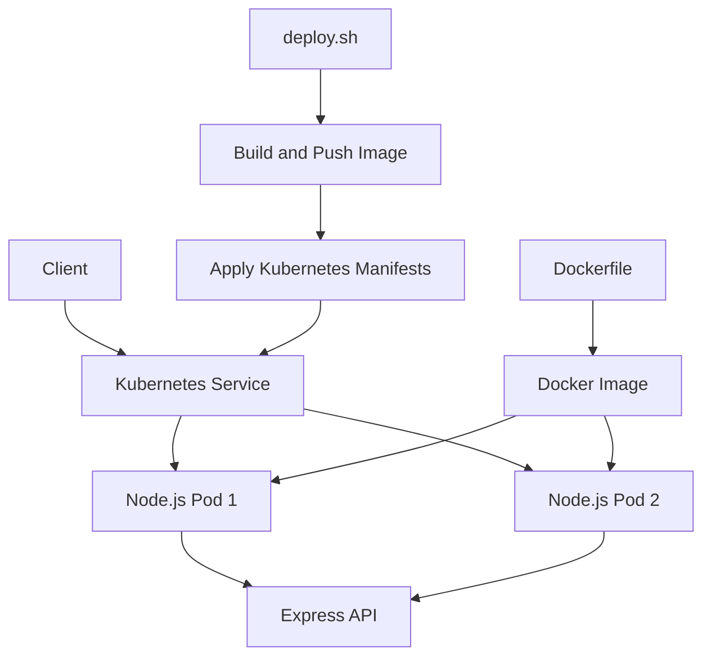

# Kubernetes Demo — Cloud-Native Node.js API

A hands-on DevOps project demonstrating how to containerize a Node.js API, deploy it to Kubernetes, expose it through a Service, and automate deployment tasks.

The project is built as a practical learning environment for container orchestration, deployment automation, application health checks, and operational troubleshooting.

> **Project status:** Local Kubernetes demonstration. Production-hardening and automated CI/CD are planned improvements, not yet claimed as completed features.

## Overview

This repository packages a Node.js and Express API into a Docker image and deploys it to a Kubernetes cluster.

The application exposes a sample endpoint, readiness and liveness checks, and basic runtime information that helps identify which pod handled a request.

## Architecture



## Technology Stack

| Technology | Purpose |
|---|---|
| Node.js | Application runtime |
| Express | HTTP API |
| Docker | Containerization |
| Docker Hub | Container image registry |
| Kubernetes | Workload orchestration |
| Minikube | Local Kubernetes cluster |
| kubectl | Kubernetes resource management |
| Bash | Deployment automation |
| Git and GitHub | Version control and collaboration |

## Repository Structure

```text
kubernetes-demo/
├── index.js
├── package.json
├── package-lock.json
├── Dockerfile
├── docker-compose.yaml
├── deploy.sh
├── .dockerignore
├── .gitignore
└── k8s/
    ├── deployment.yaml
    └── service.yaml
```

## Application Endpoints

| Endpoint | Purpose |
|---|---|
| `GET /` | Returns a JSON response with application and pod information |
| `GET /ready` | Readiness probe endpoint |
| `GET /healthz` | Liveness probe endpoint |

Example response from `GET /`:

```json
{
  "message": "Hello from a container!",
  "service": "hello-node",
  "pod": "kubernetes-demo-api-xxxxx",
  "time": "2026-10-11T02:15:37.575Z"
}
```

The pod name is supplied through the `POD_NAME` environment variable. The timestamp is generated when the request is handled.

## Prerequisites

Install or configure the following before deploying:

- Git
- Node.js and npm, for local application development
- Docker Engine
- kubectl
- Minikube or another Kubernetes cluster
- A Docker Hub account if publishing your own image

Verify your tools:

```bash
git --version
node --version
npm --version
docker --version
kubectl version --client
minikube version
```

## Run Locally

Clone the repository:

```bash
git clone https://github.com/abbas5665/kubernetes-demo.git
cd kubernetes-demo
```

Install dependencies:

```bash
npm ci
```

Start the API:

```bash
npm start
```

Test the endpoints in another terminal:

```bash
curl http://localhost:3000/
curl http://localhost:3000/ready
curl http://localhost:3000/healthz
```

Stop the application with `Ctrl+C`.

## Build and Run with Docker

Build the image:

```bash
docker build -t kubernetes-demo-api:local .
```

Start a container:

```bash
docker run --rm -p 3000:3000 kubernetes-demo-api:local
```

Test it:

```bash
curl http://localhost:3000/
```

Stop the container with `Ctrl+C`.

## Deploy to Kubernetes

Start your local cluster:

```bash
minikube start
```

Check cluster health:

```bash
kubectl get nodes
kubectl cluster-info
```

Apply the Kubernetes manifests from the repository root:

```bash
kubectl apply -f k8s/
```

Inspect the deployment:

```bash
kubectl get deployments
kubectl get pods -o wide
kubectl get services
```

Wait for the rollout to complete:

```bash
kubectl rollout status deployment/kubernetes-demo-api
```

Access the application:

```bash
minikube service kubernetes-demo-api-service
```

The command provides the URL for the locally exposed Kubernetes Service.

## Deployment Automation

The `deploy.sh` script automates the main deployment workflow:

1. Build the Docker image.
2. Push the image to Docker Hub.
3. Apply the Kubernetes Deployment and Service manifests.
4. Display deployment resources for verification.

Run it from the repository root:

```bash
npm run deploy
```

The script requires Docker Hub authentication and access to a working Kubernetes cluster. Review the script before running it in any environment.

## Troubleshooting

**Pods are not starting**

```bash
kubectl get pods
kubectl describe pods
kubectl get events --sort-by=.metadata.creationTimestamp
```

**Inspect application logs**

```bash
kubectl logs deployment/kubernetes-demo-api
```

**Check the rollout**

```bash
kubectl rollout status deployment/kubernetes-demo-api
kubectl rollout history deployment/kubernetes-demo-api
```

**Check Service endpoints**

```bash
kubectl get services
kubectl get endpointslices
```

If a pod is failing, inspect its events and logs before restarting or deleting resources.

## Security and Reliability Considerations

This project is a learning environment, not a certified production deployment.

Important areas for further hardening include:

- Pin container images to immutable versions or digests.
- Scan container images for known vulnerabilities.
- Keep credentials out of source control and container images.
- Use least-privilege Kubernetes service accounts and permissions.
- Validate resource requests, limits, and health probes.
- Add automated tests and CI checks.
- Use HTTPS and appropriate network controls where required.
- Configure centralized logging, metrics, and alerting.
- Test rollout failure, rollback, and recovery scenarios.

The `/ready` and `/healthz` endpoints currently return successful responses directly. More advanced applications should connect health checks to the dependencies and failure conditions they need to detect.

## Roadmap

- [x] Build a Node.js API
- [x] Containerize the application with Docker
- [x] Publish the image to Docker Hub
- [x] Deploy multiple replicas to Kubernetes
- [x] Expose the application through a Kubernetes Service
- [x] Automate basic deployment tasks with Bash
- [ ] Add automated unit and integration tests
- [ ] Add GitHub Actions CI
- [ ] Automate secure image publishing
- [ ] Add image vulnerability scanning
- [ ] Add Helm or Kustomize for environment-specific configuration
- [ ] Add monitoring, metrics, and alerting
- [ ] Document rollback and recovery tests

## Learning Outcomes

This project provides practical experience with:

- Container image creation and publishing
- Kubernetes Deployments, Pods, and Services
- Readiness and liveness probes
- Environment-based application configuration
- Bash-based deployment automation
- Git workflows and infrastructure troubleshooting

## Author

**Abbas Kazmi**

DevOps learning portfolio focused on Linux, Docker, Kubernetes, CI/CD, cloud infrastructure, and DevSecOps.

- GitHub: https://github.com/abbas5665
- Repository: https://github.com/abbas5665/kubernetes-demo

---

This repository is continuously evolving as new DevOps engineering practices are implemented and tested.
